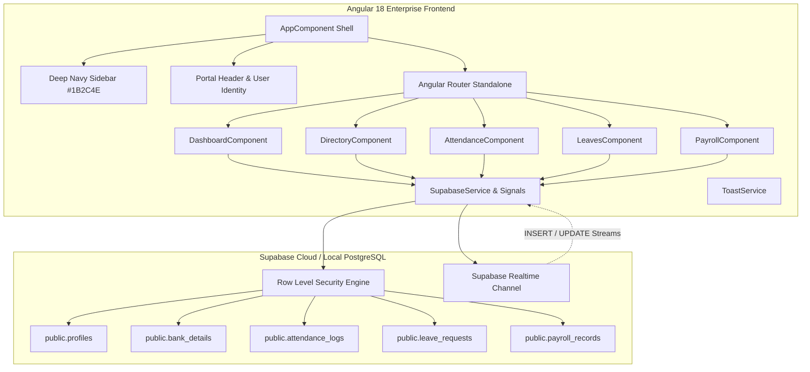

# Apex OpsPulse Enterprise Workforce Portal

> **Corporate Production & Manufacturing OS**  
> Built with **Angular 18** (Standalone Components, Signals, RxJS, Reactive Forms, Tailwind CSS, Lucide Icons) and **Supabase** (PostgreSQL, Row Level Security, Realtime Replication, Auth).

---

## 🏗️ Architecture Overview



---

## 🎨 Design Language & Color Tokens

- **Sidebar Background**: Deep Navy `#1B2C4E` (`bg-[#1B2C4E]`, active pill: `#0A7380` to `#13979B`)
- **Primary Accent**: Dark Teal `#0A7380` and Cyan Accent `#13979B`
- **Surface Cards**: Slate `#F8FAFC` and White `#FFFFFF` with soft shadows (`shadow-card`)
- **Status Badges**:
  - `Checked In`: Emerald Green (`bg-[#DEF7EC]`, `text-[#03543F]`)
  - `Checked Out`: Coral / Rose Red (`bg-[#FDE8E8]`, `text-[#9B1C1C]`)
  - `Pending Approval`: Amber (`bg-[#FEF3C7]`, `text-[#B45309]`)

---

## 🗄️ Supabase PostgreSQL DDL & RLS Policies

The complete SQL migration script is located at:
`supabase/migrations/20261025000000_apex_opspulse_schema.sql`

### Core Tables
1. **`public.profiles`**: Extends `auth.users`, includes `employee_id` (e.g. `AOP-1042`), name, role (`admin`, `supervisor`, `operator`, `hr_manager`), department, shift, phone, address, and status.
2. **`public.bank_details`**: Employee payroll accounts, bank name, IFSC/SWIFT code with cascade delete on profile removal.
3. **`public.attendance_logs`**: Shift timestamps, verification method (`manual`, `biometric`, `rfid_scan`, `qr`), and punch notes.
4. **`public.leave_requests`**: Scheduled absences (`annual`, `sick`, `casual`, `shift_swap`), approval status, and reviewer foreign key.
5. **`public.payroll_records`**: Base salary, shift allowances, deductions, and generated `net_payable` column.

### Row Level Security (RLS)
- Employees can only read and edit their own profiles and submit their own attendance punches.
- Supervisors can view team attendance and review pending leave requests.
- Users with role `admin` or `hr_manager` possess full CRUD privileges across all tables.
- Realtime replication is enabled on `supabase_realtime` publication for `attendance_logs`, `leave_requests`, and `profiles`.

---

## 🚀 Running the Portal Locally

```bash
# 1. Install dependencies
npm install

# 2. Start the development server
npm start -- --port 4250

# 3. Build production bundle
npm run build
```

Visit the application at:
`http://localhost:4250/`
